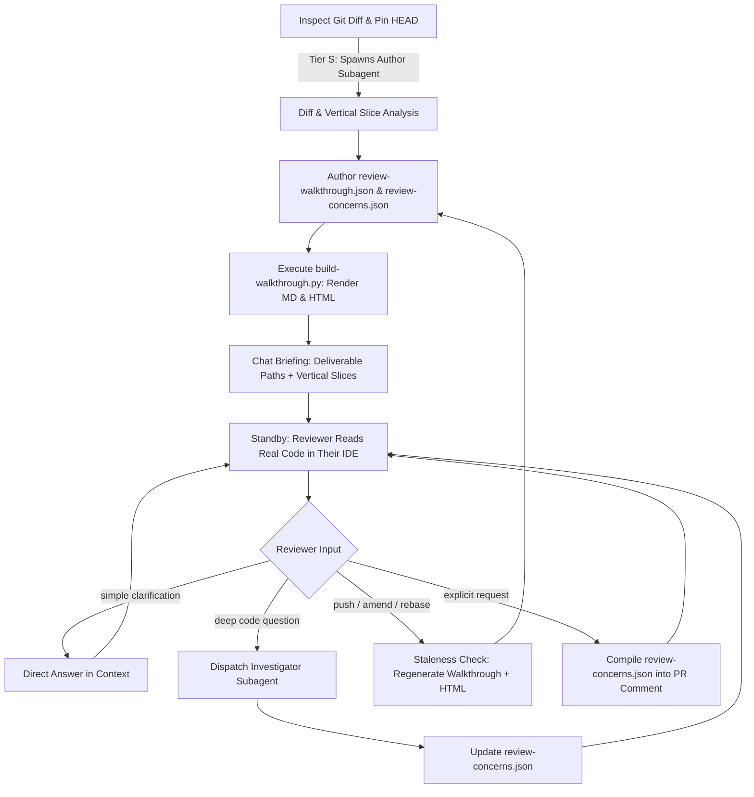

# Review Walkthrough (`review-walkthrough`)

[](https://agentskills.io)
[](../../LICENSE)

An **Anti-Fatigue Review Walkthrough Generator and On-Demand Review Co-Pilot** for AI agents, designed to maximize the depth, clarity, and speed of **human** code reviews.

---

## The Problem

Most AI code review tools dump static lints, nitpicks, or an overwhelming wall of academic text and pass/fail badges across an entire diff. When reviewing pull requests, human reviewers experience:

1. **Reading Fatigue**: Verbose formal reports with academic jargon, disclaimer banners, ASCII diagrams, and multi-row tables that stretch the scrollbar.
2. **Reviewer Blindness**: Glossing over subtle bugs or `Heads Up` risks buried in pages of fluff or dumped upfront before any code has been read.
3. **Loss of Flow**: Trying to parse 20+ files across disconnected horizontal layers or cramped wizard cards instead of cohesive workflows.

Interactive chat walkthroughs introduce problems of their own: turn-by-turn gating that fights asynchronous review habits, and trimmed code hunks trapped in a chat window — a far worse reading surface than the reviewer's own IDE, where surrounding context is one keystroke away.

## The Solution

`review-walkthrough` acts as a **lean, practical review co-pilot**. It analyzes the branch diff once, writes a structured JSON document (`review-walkthrough.json`, Schema v3) as the single source of truth, and deterministically generates both a vertical **Review Walkthrough** markdown file (`review-walkthrough.md`) and a scrollable, single-column **HTML companion** (`review-walkthrough.html`) via `scripts/build-walkthrough.py`. The reviewer reads at their own pace side-by-side with their native IDE or diff viewer, jumps straight into real code via multi-IDE deep links or 1-click Copy Path buttons, and calls on the agent only for emergent questions — answered through neutral, both-hypotheses code investigation.

---

## Key Features

- **Vertical Slice Architecture**: Organizes changes by workflow or sub-change (`Vertical Slices`) rather than horizontal technical layers. Each slice pairs its own explanation, ordered reading files, line-anchored `Heads Up` notes, and practical `QA Check` scenarios right where they apply.
- **Scrollable HTML Companion**: A self-contained, single-column scrollable HTML document (~25 KB) with zero sticky bars or bottom footer. All `Vertical Slices` render expanded by default for `Ctrl+F` search, with manual per-slice collapse persistence, a quick-jump strip when >2 slices exist, One Light / One Dark Pro themes, and automatic full expansion when printing.
- **Multi-IDE & 1-Click Copy**: Deep links for **VS Code**, **Cursor**, **Windsurf**, **Zed**, **Android Studio**, **GoLand**, and **JetBrains** (`idea://`), selectable in the top header and remembered across sessions. Dedicated 1-click Copy Path buttons (`path:line`) next to every reference pill for terminal or custom editors.
- **Full RTL & Persian Support**: Offline-first, lightweight font stack (`local("Vazirmatn")` + system UI fonts) scoped strictly to Persian (`lang="fa"`), direction-aware arrows (`←`), unified conversational prose across Markdown and HTML, and isolated Latin identifiers so paths and flags never scramble.
- **Qualitative Anti-Fatigue Scaling**: No rigid numeric caps or filler items. Single-slice trivial diffs omit duplicate `Overview` prose; clean refactors omit empty `Heads Up` and `QA Check` sections; complex changes scale naturally.
- **Collapsed `Skim List` & `Cross-Cutting` Section**: Lockfiles, docs, and generated artifacts tuck into a collapsed `<details>` `Skim List` inside `Overview`. Multi-slice `Heads Up` risks and end-to-end `QA Check` flows live cleanly in an optional `Cross-Cutting` closing section.
- **Split Recommendation**: For oversized diffs, suggests splitting the PR inside `Overview` before generating the full walkthrough.
- **Base Ref Pinning & Staleness Detection**: Pins `HEAD` at walkthrough generation time and re-checks it during review, offering to regenerate both files after a rebase or amend.
- **Subagent Context Preservation**: In multi-agent harnesses (Tier S), offloads heavy diff inspection, JSON authoring, and compiler execution to an isolated Author Subagent, preserving >95% of context headroom for standby Q&A. Emergent deep questions dispatch discretionary Investigator Subagents.
- **Persistent Review Concerns**: Tracks review findings, open questions, and agreed resolutions in `<storage-dir>/review-concerns.json`, providing a deterministic single source of truth across long sessions and compactions.
- **Progressive Tooling**: Uses graph/structural MCP tools when available; degrades gracefully to git and grep when not.
- **Anti-Bias Q&A**: Emergent questions are investigated under a both-hypotheses mandate (via a neutral investigator subagent where supported), never by confirming a predetermined answer.
- **Zero Unsolicited Output**: No automatic sign-off recaps or PR comments — logged findings in `review-concerns.json` are compiled into a ready-to-post markdown block only on explicit request.

---

## How to Trigger

In any compatible AI assistant (Claude Code, Cursor, OpenCode, Codex, Antigravity), use natural phrases like:

- *"Walk me through the changes on this branch"*
- *"Can you give me a guided code review?"*
- *"Review this PR against main"*
- *"Generate a review walkthrough for this diff"*

---

## The HTML Companion

Structured JSON (`review-walkthrough.json`, Schema v3) is the single source of truth; both Markdown and HTML are compiled in lockstep via `scripts/build-walkthrough.py`:

| Walkthrough section | HTML component |
| :--- | :--- |
| Header (title, IDE/theme toggles, branches, stats, `headSha`, `.md` file) | Non-sticky top `<header>` that scrolls out of view |
| `Overview` (optional summary, `affects`, optional `split`, collapsed `Skim List`) | Top `.card.ov` with `<details class="skim">` |
| Quick-Jump Strip (`slices.length > 2`) | Non-sticky `.qj` anchor pills (`#slice-<id>`) |
| Each `Vertical Slice` (summary, `Files` checklist, `Heads Up`, `QA Check`) | Collapsible `.card.slice` with live progress badge and `localStorage` persistence |
| `Cross-Cutting` (multi-slice `Heads Up` and end-to-end `QA Check`) | Optional closing `.card.cc` |

How it works:

- The skill authors `review-walkthrough.json` and invokes `scripts/build-walkthrough.py`, which validates the JSON against Schema v3, enriches git metadata and resolves paths against `git diff --name-only`, and compiles both `review-walkthrough.md` and `review-walkthrough.html`.
- Editor links support VS Code, Cursor, Windsurf, Zed, Android Studio, GoLand, and JetBrains (`idea://`), constructed from `git rev-parse --show-toplevel`. Reviewers can switch editors using the header dropdown or click Copy Path for terminal workflows.
- The template (`assets/walkthrough-template.html`) is ultra-lean (~25 KB) and completely self-contained. Base64 font bloat has been replaced with `local("Vazirmatn")` and native system font stacks.
- The full spec (design tokens, wording and RTL rules, JSON Schema v3, editor links, verification) is in [`references/html-walkthrough.md`](references/html-walkthrough.md).

---

## Lifecycle



---

## Installation

### Via Vercel Skills CLI
```bash
# Install directly from GitHub
npx skills add SMhdAsadi/my-skills@review-walkthrough

# Or install globally
npx skills add SMhdAsadi/my-skills@review-walkthrough --global
```

### Manual Installation
Copy or symlink `skills/review-walkthrough` into your agent harness's designated skills folder:

- **Claude Code**: `~/.claude/skills/` or project `.claude/skills/`
- **OpenCode**: `~/.opencode/skills/` or `.opencode/skills/`
- **Antigravity / Gemini CLI**: `~/.gemini/config/skills/`
- **Codex / Generic Agents**: `~/.agents/skills/`

---

## Versioning & Releases

This skill follows [Semantic Versioning](https://semver.org). Every release is:

- tagged in git as `review-walkthrough-v<version>`,
- published with notes on the [GitHub Releases page](https://github.com/SMhdAsadi/my-skills/releases),
- and recorded in [CHANGELOG.md](CHANGELOG.md).

The skills CLI installs the default branch (latest) by default. To pin a specific version, install from the tag URL:

```bash
# Latest (tracks main)
npx skills add SMhdAsadi/my-skills@review-walkthrough

# Pinned to v4.0.0
npx skills add https://github.com/SMhdAsadi/my-skills/tree/review-walkthrough-v4.0.0
```

Note: in `owner/repo@review-walkthrough`, the `@` suffix selects the *skill*, not a version — version pinning is done via the tag URL above. The current version is also recorded in `SKILL.md` under `metadata.version` (informational, per the Agent Skills spec).

---

## File Structure

```
skills/review-walkthrough/
├── SKILL.md                      # Agent instructions (Agent Skills format)
├── README.md                     # Human-facing documentation (this file)
├── CHANGELOG.md                  # Version history (Keep a Changelog)
├── assets/
│   └── walkthrough-template.html # Lean static scrollable HTML companion template (~25 KB)
├── scripts/
│   ├── build-walkthrough.py      # Forward generator: compiles JSON -> MD & HTML
│   ├── build-html.py             # Backwards-compatible delegation shim
│   ├── walkthrough_schema.py     # Schema v3 validator and path safety checks
│   └── walkthrough_generator.py  # Vertical Markdown and HTML compilation logic
└── references/
    ├── review-rubric.md          # Vertical slicing heuristics, Heads Up formulation, investigation templates
    └── html-walkthrough.md       # HTML companion spec: layout, wording, RTL, Schema v3, editor links
```

---

## License

This skill is distributed under the [MIT License](../../LICENSE).
