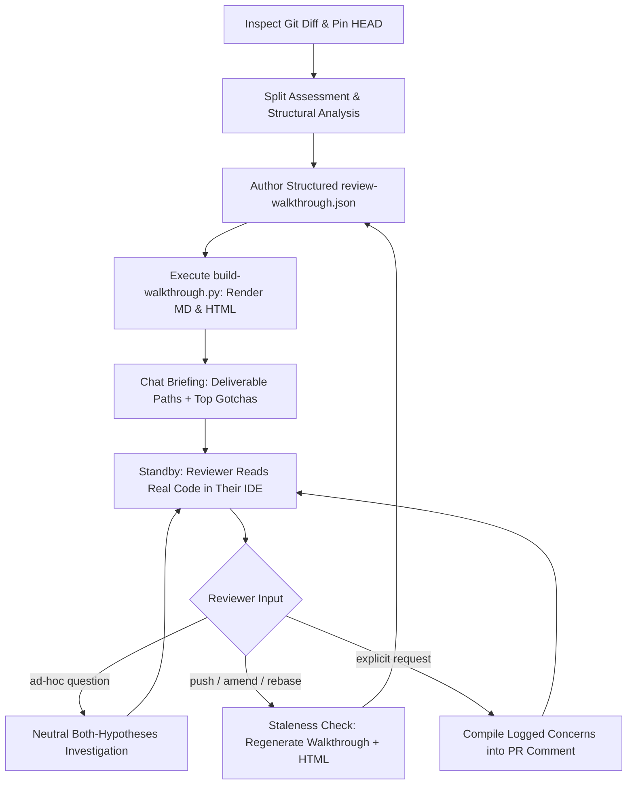

# Review Walkthrough (`review-walkthrough`)

[](https://agentskills.io)
[](../../LICENSE)

An **Anti-Fatigue Review Walkthrough Generator and On-Demand Review Co-Pilot** for AI agents, designed to maximize the depth, clarity, and speed of **human** code reviews.

---

## The Problem

Most AI code review tools dump static lints, nitpicks, or an overwhelming wall of academic text and pass/fail badges across an entire diff. When reviewing pull requests, human reviewers experience:

1. **Reading Fatigue**: Verbose formal reports with academic jargon, disclaimer banners, ASCII diagrams, and multi-row tables that stretch the scrollbar.
2. **Reviewer Blindness**: Glossing over critical gotchas or subtle bugs buried in pages of fluff.
3. **Loss of Flow**: Trying to parse 20+ files at once without a clean, file-grouped reading sequence.

Interactive chat walkthroughs introduce problems of their own: turn-by-turn gating that fights asynchronous review habits, and trimmed code hunks trapped in a chat window — a far worse reading surface than the reviewer's own IDE, where surrounding context is one keystroke away.

## The Solution

`review-walkthrough` acts as a **lean, practical review co-pilot**. It analyzes the branch diff once, writes a structured JSON document (`review-walkthrough.json`) as the single source of truth, and deterministically generates both a compact (~40–60 line) **review walkthrough** markdown file and an interactive card-based **HTML companion** via `scripts/build-walkthrough.py`. The reviewer reads at their own pace side-by-side with their native IDE or diff viewer, jumps straight into real code via multi-IDE deep links or 1-click Copy Path buttons, and calls on the agent only for emergent questions — answered through neutral, both-hypotheses code investigation.

---

## Key Features

- **Lean Review Walkthrough**: A compact, structured markdown artifact (~40–60 lines) written to an ephemeral, never-git-tracked location, opened side-by-side with your editor. Zero fluff, zero academic pretense.
- **HTML Companion**: The same walkthrough as a self-contained, presentation-style HTML file (~24 KB), one card per step. Follows your OS light/dark theme (One Light / One Dark Pro) with a manual icon override, green/red diff stats, branch tags, keyboard navigation, a checkable reading list, and zero external requests.
- **Multi-IDE & 1-Click Copy**: Deep links for **VS Code**, **Cursor**, **Windsurf**, **Zed**, **Android Studio**, **GoLand**, and **JetBrains** (`idea://`), selectable in the top bar and remembered across sessions. Dedicated 1-click Copy Path buttons (`path:line`) next to every reference pill for terminal or custom editors.
- **Full RTL & Persian Support**: Offline-first, lightweight font stack (`local("Vazirmatn")` + system UI fonts) scoped strictly to Persian (`lang="fa"`), direction-aware arrows and keyboard shortcuts, pure conversational prose, and isolated Latin identifiers so paths and flags never scramble.
- **Language-Agnostic & Conversational**: Naturally matches the language of your prompt (German, Persian, Spanish, etc.) in a relaxed, punchy peer-to-peer developer voice, with fully localized headings/labels and RTL layout preservation while keeping technical code terms intact.
- **Gotchas & Risks Upfront**: 1–4 line-anchored, practical edge cases right below the 2-sentence summary — spotting traps before you dive into the code.
- **File-Grouped Reading Order**: Logical foundation-to-leaf reading sequence grouped by file with clickable links (no fragmented line-by-line bullets or clunky ASCII trees).
- **Split Recommendation**: For oversized diffs, suggests splitting the PR before generating the walkthrough.
- **Base Ref Pinning & Staleness Detection**: Pins `HEAD` at walkthrough generation time and re-checks it during review, offering to regenerate both files after a rebase or amend.
- **Progressive Tooling**: Uses graph/structural MCP tools when available; degrades gracefully to git and grep when not.
- **Anti-Bias Q&A**: Emergent questions are investigated under a both-hypotheses mandate (via a neutral research subagent where supported), never by confirming a predetermined answer.
- **Zero Unsolicited Output**: No automatic sign-off recaps or PR comments — logged findings are compiled into a ready-to-post markdown block only on explicit request.

---

## How to Trigger

In any compatible AI assistant (Claude Code, Cursor, OpenCode, Codex, Antigravity), use natural phrases like:

- *"Walk me through the changes on this branch"*
- *"Can you give me a guided code review?"*
- *"Review this PR against main"*
- *"Generate a review walkthrough for this diff"*

---

## The HTML Companion

Structured JSON (`review-walkthrough.json`) is the single source of truth; both Markdown and HTML are generated in lockstep via `scripts/build-walkthrough.py`. Each walkthrough section corresponds directly to a step:

| Walkthrough section | HTML step |
| :--- | :--- |
| Header, scope bar, The Gist | Scope card |
| Split Recommendation (large diffs only) | Split card |
| Each Heads Up gotcha | One card per gotcha, with pure prose, `.ref-pill` rows, deep links, and copy buttons |
| Suggested Reading Order + Skim | Checkable reading list (scrollable for >6 files) |
| What to Test | Test card |

How it works:

- The skill authors `review-walkthrough.json` and invokes `scripts/build-walkthrough.py`, which validates the JSON against Schema v2, enriches git metadata and paths against `git diff --name-only`, and compiles both `review-walkthrough.md` and `review-walkthrough.html`.
- Editor links support VS Code, Cursor, Windsurf, Zed, Android Studio, GoLand, and JetBrains (`idea://`), constructed from `git rev-parse --show-toplevel`. Reviewers can switch editors using the header dropdown or click Copy Path for terminal workflows.
- The template (`assets/walkthrough-template.html`) is ultra-lean (~24 KB) and completely self-contained. Base64 font bloat has been removed in favor of `local("Vazirmatn")` and native system font stacks.
- The full spec (design tokens, wording and RTL rules, JSON schema, editor links, verification) is in [`references/html-walkthrough.md`](references/html-walkthrough.md).

---

## Lifecycle



---

## Installation

### Via Vercel Skills CLI
```bash
# Install directly from GitHub
npx skills add SMhdAsadi/my-skills@review-walkthrough

# Or install globally
npx skills add SMhdAsadi/my-skills@review-walkthrough --global
```

### Manual Installation
Copy or symlink `skills/review-walkthrough` into your agent harness's designated skills folder:

- **Claude Code**: `~/.claude/skills/` or project `.claude/skills/`
- **OpenCode**: `~/.opencode/skills/` or `.opencode/skills/`
- **Antigravity / Gemini CLI**: `~/.gemini/config/skills/`
- **Codex / Generic Agents**: `~/.agents/skills/`

---

## Versioning & Releases

This skill follows [Semantic Versioning](https://semver.org). Every release is:

- tagged in git as `review-walkthrough-v<version>`,
- published with notes on the [GitHub Releases page](https://github.com/SMhdAsadi/my-skills/releases),
- and recorded in [CHANGELOG.md](CHANGELOG.md).

The skills CLI installs the default branch (latest) by default. To pin a specific version, install from the tag URL:

```bash
# Latest (tracks main)
npx skills add SMhdAsadi/my-skills@review-walkthrough

# Pinned to v3.0.0
npx skills add https://github.com/SMhdAsadi/my-skills/tree/review-walkthrough-v3.0.0
```

Note: in `owner/repo@review-walkthrough`, the `@` suffix selects the *skill*, not a version — version pinning is done via the tag URL above. The current version is also recorded in `SKILL.md` under `metadata.version` (informational, per the Agent Skills spec).

---

## File Structure

```
skills/review-walkthrough/
├── SKILL.md                      # Agent instructions (Agent Skills format)
├── README.md                     # Human-facing documentation (this file)
├── CHANGELOG.md                  # Version history (Keep a Changelog)
├── assets/
│   └── walkthrough-template.html # Lean static HTML companion template (~24 KB)
├── scripts/
│   ├── build-walkthrough.py      # Forward generator: compiles JSON -> MD & HTML
│   ├── build-html.py             # Backwards-compatible delegation shim
│   ├── walkthrough_schema.py     # Schema v2 validator and path safety checks
│   └── walkthrough_generator.py  # Markdown and HTML compilation logic
└── references/
    ├── review-rubric.md          # Layering heuristics, risk-hypothesis formulas, investigation templates
    └── html-walkthrough.md       # HTML companion spec: design, wording, RTL, JSON schema, editor links
```

---

## License

This skill is distributed under the [MIT License](../../LICENSE).